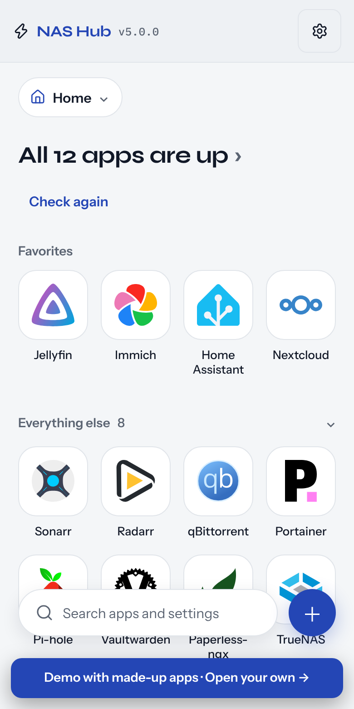
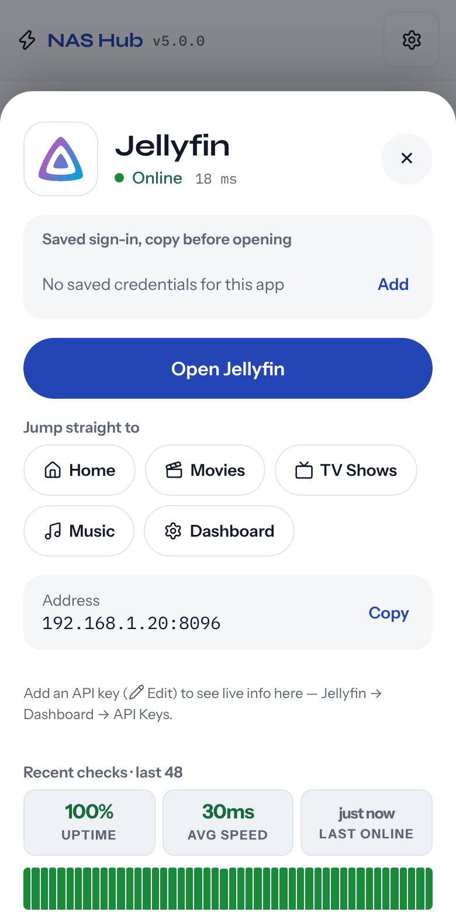
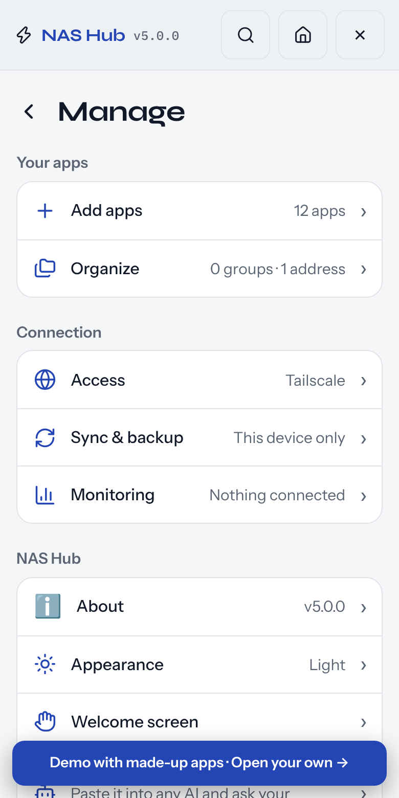

# NAS Hub

A home screen for the apps on your home server, made for phones.

NAS Hub puts Jellyfin, Immich, Home Assistant and everything else you host one tap away, and shows which ones are up. It is a single web page that installs to your home screen like an app. Your setup stays in your own browser. There is no account, nothing to buy, and every feature is included.

**Try it now:** [app.nashubapp.com](https://app.nashubapp.com) (or [look around with made up apps](https://app.nashubapp.com/?demo=1))

| Home | An app | Manage |
|---|---|---|
|  |  |  |

## What it does

- One tap tiles for your apps, with real logos for about 50 popular ones and a catalog to add from.
- Up or down status for each app, a recent history strip, and a 24 hour uptime view.
- Home and Away modes, so the same tile opens the local address at home and the Tailscale address when you are out.
- TrueNAS and Portainer import, a network scanner, and spreadsheet import and export.
- Kid and guest mode: only the apps you choose, with a PIN to leave.
- Starter packs, and packs you make yourself. Addresses and passwords are never included in a pack.
- Backup to a file or a code, and optional Face ID or fingerprint lock.
- Optional Group Sync for a household: one person manages the list and everyone else gets it. This needs a small sync server that you host yourself (see below).

## Install

Pick one. All three serve the same files.

### Docker

```
docker run -d --name nashub --restart unless-stopped -p 8765:80 nashubapp/nashub:latest
```

Then open `http://YOUR-SERVER-ADDRESS:8765` on your phone and add it to your home screen.

Or with Compose, using the `docker-compose.yml` in this repo:

```
docker compose up -d
```

To build the image yourself:

```
docker build -t nashub .
```

### TrueNAS

1. Apps, Discover Apps, Custom App.
2. Application name: `nashub`.
3. Image repository: `nashubapp/nashub`, tag `latest`.
4. Under Network Configuration add a port: container port `80`, host port `8765`.
5. Install, then open `http://YOUR-NAS-ADDRESS:8765`.

### Plain files

Download the zip from the [Releases](../../releases) page, unzip it, and serve the folder with any web server. Nothing needs to be built. The `app` folder of this repo is the same set of files.

A note on addresses: browsers do not let a secure page (`https://`) check or open plain `http://` addresses in the background. Running NAS Hub from your own server over `http://` on your home network avoids that, and is the main reason to host it yourself.

## Update

- **Docker:** `docker pull nashubapp/nashub:latest`, then remove and start the container again (or `docker compose pull && docker compose up -d`).
- **TrueNAS:** open the app, choose Edit or Update, and let it pull the image again.
- **Plain files:** replace the files with the ones from the new zip.

Your apps and settings live in the browser on each device, so an update does not touch them. The version shows next to the name at the top of the app. Each release has a note in [CHANGELOG.md](CHANGELOG.md).

## Group Sync (optional, you host it)

Group Sync, short share links, online backup, the TrueNAS bridge and down alerts all talk to one small sync server. There is no shared one. You run your own copy on a free Cloudflare account in about ten minutes: follow [sync-server/README.md](sync-server/README.md), then enter its address in the app under Manage, Sync and backup, Group Sync.

Everything else in the app works without it.

## Help

- [app/help/NASHUB-AI-HELP.md](app/help/NASHUB-AI-HELP.md) describes how the app really behaves. Paste it into any AI assistant and ask your question.
- Found a bug? Open an issue. Please include the version, your device and browser, and the exact message you saw.

## License and credits

MIT. See [LICENSE](LICENSE).

App logos come from [Dashboard Icons](https://github.com/homarr-labs/dashboard-icons) (Apache 2.0). Fonts are IBM Plex Mono, Instrument Sans and Syne; their licenses are in `app/fonts/LICENSES.txt`.

Made by [Dave Doing Dave Stuff](https://davedoingdavestuff.com/?utm_source=nashub&utm_medium=readme&utm_campaign=credit)
